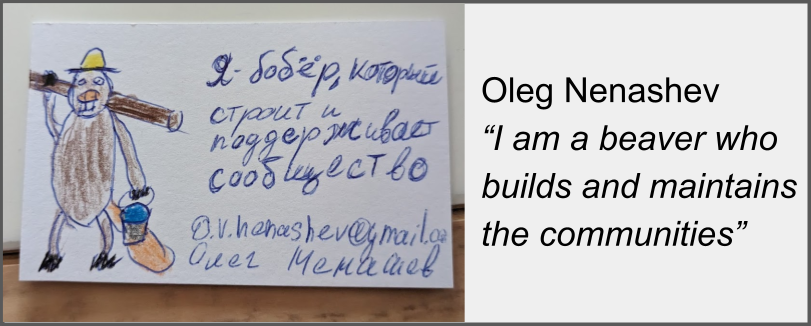

#  Oleg in Open Source

I started contributing open source in 2012, and I liked being a part of the global community.
From a contributor to maintainer and community leader,
open source has been a key part of my career since 2015.
And I plan to continue like that!

## My participation in open source

- [My Open Source Projects](../open-source/projects/README.md)
- [My Open Source Organizations](../open-source/organizations/README.md)
- [Open Source Mentorship and outreach programs](../open-source/mentorship/README.md)
- [Community Building](../work/community-building.md)

## Consulting

I am available as an open source and community building advisor.
From go-to-market and go-to-community for open source projects
to building complex ecosystems and community platforms.
[Learn more](../consulting/community-building.md).

!!! quote "References - Software Developer Advocate Consultant at WireMock Inc."

    During his assignment Mr. Nenashev... quadrupled community GitHub contributions to WireMock in 9 months...

    The client states that Mr. Nenashev has played a pivotal role in fostering open-source collaboration and community growth;
    his initiatives extended beyond mere developer advocacy and code contributions.
    Mr. Nenashev established the community governance framework, communication channels, and
    vibrant social media presence, organized events,
    and onboarded many 3rd-party projects to the main GitHub organization.
    His efforts helped to expand the WireMock ecosystem, particularly in the Golang and Python technology stacks

    // Work certificate for the mission at [WireMock Inc.](https://www.wiremock.io/) as a Software Developer Advocate Consultant,
    from April 2023 to January 2024
