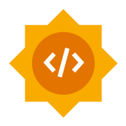
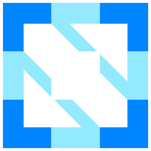
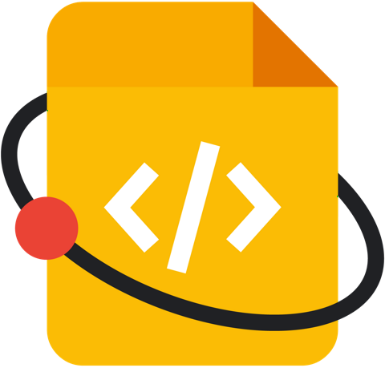
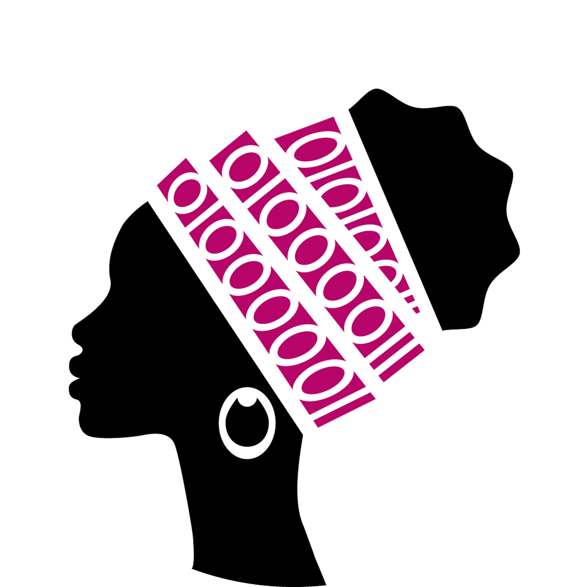
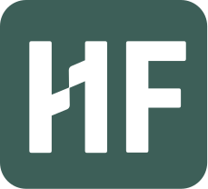

# My Open Source Mentorship

Mentorship is one of my favorite ways to contribute to open source.
Over the years, I've participated in mentorship and outreach programs as a mentor, organizer and advisor.
My work has covered open source developer and automation tools, cloud-native technologies, technical documentation, and open hardware.

## Google Summer of Code

[Google Summer of Code (GSoC)](https://summerofcode.withgoogle.com/) (GSoC) is a global, online program focused on bringing students and new contributors into open source software development.
GSoC Contributors work with an open source organization on a 12+ weeks-long programming project under the guidance of dedicated mentors.
It is one of the biggest open source programs in the world.

I've been involved since 2015 as a mentor, org admin, technical and community advisor.
My organizations included
Jenkins, the Free and Open Source Silicon Foundation (FOSSi), the Continuous Delivery Foundation (CDF), Kotlin Foundation and Eclipse Foundation.

[My participation in GSoC](./gsoc.md).

## CNCF Merge Forward {: style="clear: right" }

[CNCF Merge Forward](https://community.cncf.io/merge-forward/) builds supportive networks for contributors from underrepresented groups in the cloud-native ecosystem.

In 2026, I've became a mentor-buddy in a program that supports individuals from underrepresented groups—whether by helping them navigate open-source contributions, co-presenting at conferences, or offering career guidance. Even small actions can make a big difference in someone's journey.

## Google Season of Docs {: style="clear: right" }

I believe documentation is as important as code, and documentation work is a great path into open source communities.
[Google Season of Docs](https://developers.google.com/season-of-docs) connects open source projects with technical writers to improve documentation.

In **2020**, I participated in the Jenkins program as an **organization administrator and project mentor**.
I was one of the mentors of [Document Jenkins on Kubernetes](https://www.jenkins.io/sigs/docs/gsod/2020/projects/document-jenkins-on-kubernetes/), a project to make it easier to understand and document running Jenkins on Kubernetes.

### LFX Mentorship / CommunityBridge {: style="clear: right" }

[LFX Mentorship](https://mentorship.linuxfoundation.org/), previously CommunityBridge, connects new contributors with mentors in open source projects.

In **2019**, I helped the Jenkins community establish its CommunityBridge participation and support opportunities beyond the Google Summer of Code calendar.
We were one of the first projects to pilot the LFX Mentorship program from the Linux Foundation.

Its first project, [Developer Tools for Jenkins Configuration as Code](https://www.jenkins.io/projects/jcasc/dev-tools/),
ran from August to November 2019.
My role was in helping establish and support the initiative as an advisor rather than being a named project mentor.

## She Code Africa Contributhon {: style="clear: right" }

[She Code Africa](https://www.shecodeafrica.org/) supports women in technology across Africa. Its **Contributhon** program gives aspiring contributors an opportunity to work with open source communities and dedicated mentors.

I was a **mentor for the Jenkins project in the 2021 Contributhon**, helping participants get started with contributing and collaborating with maintainers. The program focused on Jenkins Pipeline examples and plugin documentation.

[Meet the Jenkins Contributhon participants](https://www.jenkins.io/blog/2021/04/07/contributhon-participants/)

## Other Mentorship and Contributor Outreach Programs {: style="clear: right" }

The initiatives below are also part of my open source community work - running community programs and events in open source projects.
My involvement was focused more on organization, contributor onboarding and support.

### Outreachy

[Outreachy](https://www.outreachy.org/) offers paid open source internships to people facing underrepresentation and systemic barriers in technology.

I supported discussions and organizational work around Jenkins' participation in Outreachy. My documented involvement was on the **community and program-support side**, rather than as a named project mentor.

### Hacktoberfest {: style="clear: right" }

[Hacktoberfest](https://hacktoberfest.com/) is an annual celebration of open source contributions. I helped initiate and organize **Jenkins' participation**, with a focus on creating approachable opportunities for first-time contributors.

Hacktoberfest is not a formal one-on-one mentorship program, but code reviews, contributor guidance, and a welcoming first contribution experience can make a lasting difference.

[Hacktoberfest at Jenkins](https://www.jenkins.io/events/hacktoberfest/),
[Hacktoberfest at WireMock](https://www.wiremock.io/post/hacktoberfest-2023)

## Related Talks {: style="clear: right" }

- [Mentorship programs: Growing new team and community leaders](../../speaking/talks/culture/mentorship-programs-growing-new-team-and-community-leaders.md) explores mentorship and outreach as ways to grow maintainers and leaders.
- [Mentorship programs for students in open source: Industry/Academia Partnerships](../../speaking/talks/culture/open-source-mentorships-and-academia-partnerships.md) discusses partnerships with universities, including GSoC.

<!-- TODO: ## Mentoring beyond Open Source -->
